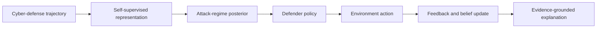

# CybSAGE-MARL

<div align="center">

**Self-Supervised Context-Aware Multi-Agent Reinforcement Learning for Adaptive Cyber Defense**

Research code, executed notebooks, curated experiment evidence, and an interactive CAGE-4 research console.

[Interactive simulation](https://deepakvermalab.github.io/CybeSage-MARL-Simulation/) · [Pipeline](docs/PIPELINE.md) · [Results tracking](docs/RESULTS_TRACKING.md) · [Repository map](docs/REPOSITORY_MAP.md)

</div>

---

## Project status

| Component | State | Evidence boundary |
|---|---|---|
| CPU prototype pipeline | Implemented and executed | Synthetic trajectories and prototype models |
| CAGE-4 baseline suite | Implemented and executed | Six heuristic baselines |
| CAGE-4 CybSAGE profile | Implemented and executed | Tuned `alert_response_decoy` rule/profile policy |
| Interactive research console | Implemented and verified | Recorded traces plus separately labelled prototype explanations |
| End-to-end learned CybSAGE-MARL | Future research stage | SSL, online posterior, and learned MARL are not yet integrated in real CAGE-4 |

> **Scientific claim boundary:** the retained CAGE-4 evidence compares a tuned heuristic/profile policy with six executed heuristic baselines under the recorded protocol. It does not establish superiority over published MARL methods.

## Method overview



The repository contains a runnable CPU-first prototype of this chain, followed by real CybORG/CAGE-4 baseline and profile-policy experiments. The architecture and current implementation boundary are documented in [docs/PIPELINE.md](docs/PIPELINE.md).

## Repository structure

```text
.
├── configs/              Project configuration
├── deployment/           Research-console source, exporter, and paper screenshots
├── docs/                 Pipeline, results, and repository documentation
├── logs/                 Curated execution and transfer logs
├── notebooks/            Stage-wise executable research notebooks
├── results/              Curated, lightweight result summaries tracked in Git
├── scripts/              Stage runner, validation, and synchronization utilities
├── src/cybsage_marl/     Python research package
├── tests/                Unit tests
├── pyproject.toml        Package and dependency definition
└── requirements.txt      Environment requirements
```

Large generated outputs, datasets, embeddings, and model checkpoints are intentionally excluded from Git. See [docs/RESULTS_TRACKING.md](docs/RESULTS_TRACKING.md).

## Installation

Python 3.10 or newer is required.

```bash
git clone https://github.com/DeepakVermaLab/CybeSage-MARL.git
cd CybeSage-MARL

python3 -m venv .venv
source .venv/bin/activate
python -m pip install --upgrade pip
python -m pip install -e '.[dev]'
```

For real CAGE-4 execution, install the optional environment dependencies:

```bash
python -m pip install -e '.[dev,cage4]'
```

Dataset locations can be adapted through `configs/project.json` or the discovery logic in `src/cybsage_marl/config.py`. Datasets are not distributed in this repository.

## Required datasets

- CybORG CAGE Challenge 4
- MITRE ATT&CK Enterprise STIX
- NVD CVE API 2.0 archive

The data audit expects these assets under a common security-dataset root. Refer to `configs/project.json` for the local configuration schema.

## Stage runner

Run individual stages from the repository root:

```bash
python scripts/run_stage.py audit
python scripts/run_stage.py trajectories --episodes 200
python scripts/run_stage.py preprocess
python scripts/run_stage.py eda
python scripts/run_stage.py cti --nvd-limit 5000
python scripts/run_stage.py ssl --epochs 5
python scripts/run_stage.py marl --epochs 5
python scripts/run_stage.py explain
python scripts/run_stage.py evaluate
python scripts/run_stage.py ablation --epochs 5 --ablation-seeds 42 43 44 45 46
python scripts/run_stage.py statistical
python scripts/run_stage.py cage4_check
python scripts/run_stage.py cage4_baselines
python scripts/run_stage.py cage4_cybsage
python scripts/run_stage.py cage4_sota
python scripts/run_stage.py cage4_sci_readiness --sci-min-paired-runs 30
```

## Notebook workflow

The notebooks mirror the pipeline and retain printed execution outputs:

| Range | Purpose |
|---|---|
| `00`–`05` | Environment, dataset audit, trajectories, preprocessing, EDA, and CTI graph |
| `06`–`08` | SSL encoder, posterior-policy prototype, and explanations |
| `09`–`11` | Evaluation, ablation, and statistical analysis |
| `12`–`16` | CAGE-4 dependencies, baselines, profile policy, comparison, and readiness pack |
| `17` | Expanded CAGE-4 experiment orchestration |

Run notebooks in numeric order. Colab users must mount Google Drive and select paths visible to the remote kernel.

## Retained results

The lightweight [results](results/) directory contains the paper-facing summaries and training logs selected from the completed runs. Key recorded values include:

- 30 held-out CybSAGE CAGE-4 episodes on evaluation seeds 52–61.
- Mean reward `-59.3` with standard deviation `30.4644` for the selected profile.
- Six executed heuristic baselines and six paired effect-size comparisons.
- 100 prototype explanation records with 0.91 evidence coverage.
- Explicitly uninstrumented energy consumption; no joule-level claim is made.

## Interactive simulation

The publication-oriented research console is maintained in `deployment/`. A separate public repository hosts the static experience:

**https://deepakvermalab.github.io/CybeSage-MARL-Simulation/**

To refresh and preview the console locally:

```bash
python deployment/scripts/export_artifacts.py
python -m http.server 8765 --directory deployment/dist
```

Then open `http://localhost:8765/`.

## Verification

```bash
python -m pytest -q
python scripts/verify_install.py
node --check deployment/dist/app.js
```

Some real CAGE-4 checks require the optional dependencies and local dataset checkout.

## Reproducibility notes

- Seeds and split definitions are retained in configuration and result artifacts.
- Each stage writes a `stage_manifest.json` in the complete local output tree.
- Curated logs and summaries are tracked; bulky intermediate arrays and model files are not.
- Recorded CAGE-4 playback and synthetic prototype explanation evidence remain clearly separated.
- Public simulation data contains no credentials, datasets, or absolute local paths.

## Responsible use

This repository is intended for defensive cybersecurity research and reproducible experimentation in simulated environments. It is not a production SOC controller and should not be used to automate actions against systems without authorization.
